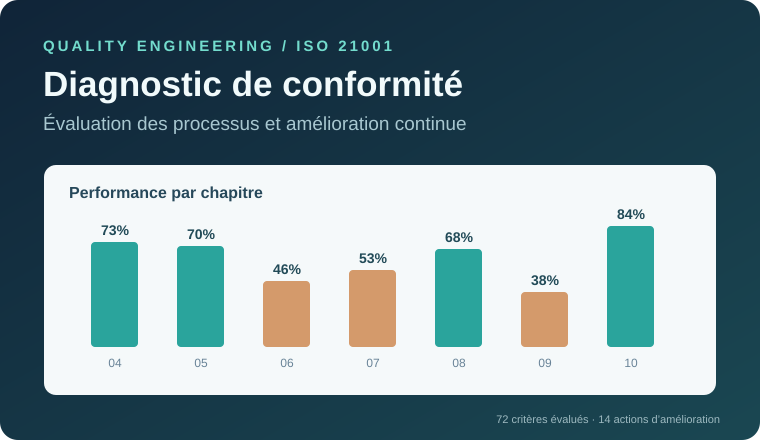

# Diagnostic de conformité ISO 21001 et amélioration continue

**Étude de cas : école d'ingénieurs · Management de la qualité · Diagnostic organisationnel**

[**🌐 OUVRIR LA DÉMO INTERACTIVE**](https://elmokhtarrayadi.github.io/diagnostic-iso-21001/)

[Consulter le code de l’application](./index.html)



## Résumé du projet

**Problème étudié.** Comment identifier les faiblesses du management de la qualité dans une **école d'ingénieurs**, comprendre les causes possibles des dysfonctionnements et proposer des mesures de progrès ?

**Travail présenté.** Une évaluation des pratiques à l'aide de **72 critères numérotés**, suivie de l'interprétation des écarts, d'une analyse de **15 facteurs potentiels** par Ishikawa 5M, et d'un **plan de 14 actions proposées** avec responsables, délais et indicateurs.

**Résultat important.** Le domaine de la **planification** affiche **46 % de conformité** dans le diagnostic et fait partie des priorités d'amélioration. L'étude met également en évidence des données à consolider (71 évaluations dans la synthèse contre 72 critères numérotés ; 38 % ou 54 % pour l'article 9). Il ne s'agit ni d'une certification ni d'une amélioration déjà réalisée.

## Démarche d'ingénierie qualité

L'étude s'organise autour des **décisions à prendre à partir du diagnostic**, et non autour d'une présentation successive des chapitres de la norme :

| Étape | Question traitée | Travail présenté |
| :--- | :--- | :--- |
| **1. Évaluer** | Où en sont les pratiques ? | Grille de diagnostic, critères et niveaux de conformité |
| **2. Identifier** | Quels écarts faut-il traiter ? | Résultats, non-conformités et domaines prioritaires |
| **3. Analyser** | Quelles causes pourraient expliquer les écarts ? | Diagramme Ishikawa, cinq familles 5M |
| **4. Proposer** | Quelles mesures concrètes retenir ? | Plan d'action, responsables, délais et KPI |
| **5. Comparer** | Comment interpréter un scénario théorique ? | Simulation illustrative des taux, sans prétendre à un progrès mesuré |

Les **articles ISO 21001** sont conservés dans la grille détaillée comme référentiel de vérification. La cartographie des processus sert de proposition méthodologique, sans supposer qu'elle a déjà été déployée.

## Identifier les écarts et les priorités

Les critères détaillés permettent d'identifier des besoins concrets, par exemple :

| Critère | Constats d'évaluation | Score | Réponse proposée |
| :--- | :--- | ---: | :--- |
| `cr22` | Identification des risques | 30 % | Cartographie des risques (3 mois) |
| `cr25` | Objectifs éducatifs mesurables | 30 % | Objectifs SMART et KPI (2 mois) |
| `cr40` | Maîtrise documentaire | 30 % | Procédure documentaire (2 mois) |
| `cr62` | Programme d'audit interne | 0 % | Audits périodiques (6 mois) |

Ces durées correspondent au **plan d'action proposé** ; elles ne sont pas présentées comme des délais réellement tenus.

## Rechercher les causes des écarts — Ishikawa 5M

Le diagramme regroupe les **15 facteurs** examinés selon cinq catégories :

| Catégorie | Facteurs principaux |
| :--- | :--- |
| **Main-d'œuvre** | Sensibilisation limitée, formation insuffisante, faible implication des acteurs |
| **Méthodes** | Procédures non formalisées, manque de KPI, suivi pédagogique insuffisant |
| **Milieu** | Communication interne, complexité organisationnelle, résistance au changement |
| **Matériel** | Équipements limités, outils numériques insuffisants, ressources techniques insuffisantes |
| **Matière** | Documentation incomplète, supports non standardisés, traçabilité insuffisante |

Le diagramme est interactif : chaque famille donne accès à une explication des facteurs et aux mesures d'amélioration associées. **Ces facteurs sont des causes potentielles à confirmer**, et non des causes ayant fait l'objet d'une démonstration causale chiffrée.

## Plan d'amélioration proposé

Les **14 actions** structurent les réponses envisagées aux écarts : gouvernance qualité, risques, objectifs SMART, formation, maîtrise documentaire, audits internes et suivi des indicateurs.

Chaque ligne du plan indique un responsable proposé, un délai prévisionnel et un indicateur de suivi. **Aucune action n'est présentée comme achevée** ; leur efficacité nécessiterait une mise en œuvre et une évaluation ultérieure.

## Référentiel technique — exigences ISO 21001

Les sept articles d'exigences (4 à 10) permettent de retrouver le rattachement normatif des évaluations. Ils constituent un **niveau de détail technique**, et non les étapes principales du projet.

| Référence ISO 21001 | Domaine évalué | Conformité relevée |
| :--- | :--- | ---: |
| 4 | Contexte de l'organisme | 73 % |
| 5 | Leadership | 70 % |
| 6 | Planification | **46 %** |
| 7 | Support | 53 % |
| 8 | Réalisation des activités éducatives | 68 % |
| 9 | Évaluation des performances | **38 %*** |
| 10 | Amélioration | 84 % |

*Pour l'évaluation des performances (article 9), deux valeurs contradictoires sont présentes dans les données : **38 %** et **54 %**. L'application retient **38 %** pour l'affichage et signale cet écart ; sa vérification reste nécessaire.*

### Vérification de la grille d'évaluation

- **72 critères numérotés** de `cr1` à `cr72`, regroupés selon les sept domaines d'exigences ISO 21001.
- Barème de véracité de **0 %, 30 %, 70 % et 100 %**.
- Répartition constatée en reprenant les lignes numérotées : **21 satisfaisants, 25 partiellement conformes à 70 %, 22 partiellement conformes à 30 %, 4 non conformes** — soit 72 au total.
- Le tableau récapitulatif annonce **71 évaluations**, dont **3 non conformes**. La différence ne doit pas être masquée ; les statistiques de la grille interactive reposent sur les 72 lignes effectivement numérotées.

Les taux par domaine correspondent aux valeurs reprises dans le diagnostic ; ils ne sont pas présentés comme des moyennes recalculées à partir des 72 critères. Les divergences identifiées doivent être vérifiées.

## Explorer l'application interactive

La [**démonstration ISO 21001**](https://elmokhtarrayadi.github.io/diagnostic-iso-21001/) reprend la démarche en six rubriques : synthèse, évaluation de la conformité, identification des écarts, analyse Ishikawa, planification des actions et comparaison de scénarios.

Le visiteur peut **rechercher et filtrer les 72 critères**, consulter les évaluations détaillées par article ISO, explorer les branches de l'Ishikawa, filtrer et exporter le plan d'action au format CSV, et modifier les taux dans une **simulation pédagogique**. Cette simulation n'est pas une mesure de résultats obtenus.

## Démarche qualité

La démarche s'appuie sur la logique **PDCA (Plan–Do–Check–Act)**, sur la structuration des processus et sur l'analyse des risques et opportunités. La réflexion prend également en compte le **cadre réglementaire marocain** et la complémentarité entre ISO 9001 et ISO 21001 dans les organismes d'éducation.

## Organisation technique

```text
diagnostic-iso-21001/
├── index.html          # Présentation et exploration interactive
├── style.css           # Interface responsive et tableaux de bord
├── app.js              # Navigation, Ishikawa, actions, simulation
├── audit.js            # 72 critères évalués, recherche, filtres, export
├── cover.svg           # Aperçu du projet
└── README.md           # Présentation technique
```

Application statique HTML/CSS/JavaScript, sans compte utilisateur ni stockage externe.

---

**Étude académique collective · Établissement anonymisé.** Les résultats présentés ne constituent ni un audit de certification ni la preuve d'un déploiement effectif des recommandations.

**Elmokhtar Rayadi** — Étudiant ingénieur en génie mécanique des systèmes industriels.

[**Retour au portfolio**](https://github.com/elmokhtarrayadi)